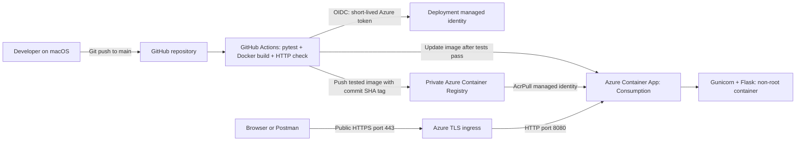

# B9IS121 CI/CD learning project

DeployLab is an interactive Flask dashboard by Besil Killthatill Eldho. It has a
responsive interface, an API playground with response/header views, and four real
HTTP checks. It demonstrates Docker packaging and automated deployment to Azure
Container Apps from GitHub Actions. Current release: **2.0**.

- `/` serves the dashboard from `templates/index.html` and `static/`.
- `/api/health` returns JSON application health.
- `/api/version` returns the release and build commit.
- **Run live checks** tests health, release, expected 404 and expected 405 responses.

Displayed request timings come from the browser. The architecture diagram describes
the configured workflow; pipeline execution history is linked to GitHub Actions.

Live application: https://b9is121-app.victoriouspebble-d3aeb62f.francecentral.azurecontainerapps.io/

Pipeline runs: https://github.com/Besilkilithattil/b9is121-cicd-project/actions

This is an **AI-assisted learning scaffold**, not a claim of independently
authored coursework. Read [LEARNING_NOTES.md](LEARNING_NOTES.md), understand the
implementation, and declare assistance in the submitted assessment.

## Run and test locally

```sh
python3 -m venv .venv
source .venv/bin/activate
python -m pip install -r requirements-dev.txt
python -m pytest -q
python -m flask --app app run --port 8000
```

Visit `http://127.0.0.1:8000`. Stop the server with Ctrl+C.

To run the production-style container locally:

```sh
docker build -t b9is121-app:local .
docker run --rm -p 127.0.0.1:18080:8080 b9is121-app:local
```

Visit `http://127.0.0.1:18080`. Port 18080 avoids a local port 8080 conflict.

## Pipeline and network diagram



The Azure resources are in `rg-b9is121`, France Central. The app uses 0.25 CPU
and 0.5 GiB memory, with a minimum of zero and maximum of one replica. There is
no database, persistent application storage, or custom virtual network.

Pull requests run tests and build checks. Pushes to `main` additionally publish
the **same tested image**, deploy it, and compare the HTTPS response with the
local container response. The image tag is the full Git commit SHA. Any failing
step stops the job before later steps execute.

## Azure authentication and configuration

The bootstrap resources were created with Azure CLI. The runtime identity
`b9is121-pull` has `AcrPull` on the registry. The deployment identity
`b9is121-github` has `AcrPush` on the registry and `Container Apps Contributor`
on the application. Its federated credential trusts only this repository's
`main` branch. Registry admin credentials are disabled.

The workflow reads these GitHub Actions repository variables:

- `AZURE_CLIENT_ID`, `AZURE_TENANT_ID`, `AZURE_SUBSCRIPTION_ID`
- `AZURE_RESOURCE_GROUP`, `AZURE_CONTAINER_APP`
- `ACR_NAME`, `ACR_LOGIN_SERVER`

These values identify the Azure resources. No long-lived Azure password or
client secret is stored in this repository.

## Demonstrating an update

1. Change `VERSION` in `app.py`, update the expected release in `test_app.py`
   and the Postman collection, and save the files.
2. Run `python -m pytest -q`.
3. Commit and push the change to `main`.
4. Open GitHub Actions and wait for every pipeline step to pass.
5. Refresh the public Azure URL and run the Postman requests again.
6. Show the commit, successful run, and matching new version in the recording.

## Costs and limitations

The Basic registry costs approximately USD 0.1666/day in France Central at the
rate checked on 9 November 2026, even when the app is idle. Container Apps
Consumption can scale to zero; active usage and traffic may incur charges
beyond free allowances. Monitor the student credit in Azure Cost Management.

Cold starts, a single-replica maximum, a mutable Python base-image tag, no
automated image vulnerability scan, and no durable central log retention are
limitations to discuss. This example has no user authentication or data store.

After assessment and when the public URL is no longer needed, remove
`rg-b9is121` in Azure to stop ongoing registry costs. Deleting it destroys all
the cloud resources for this project.
